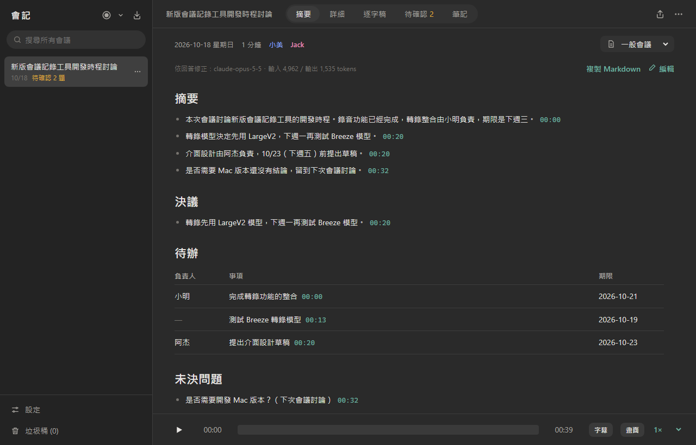
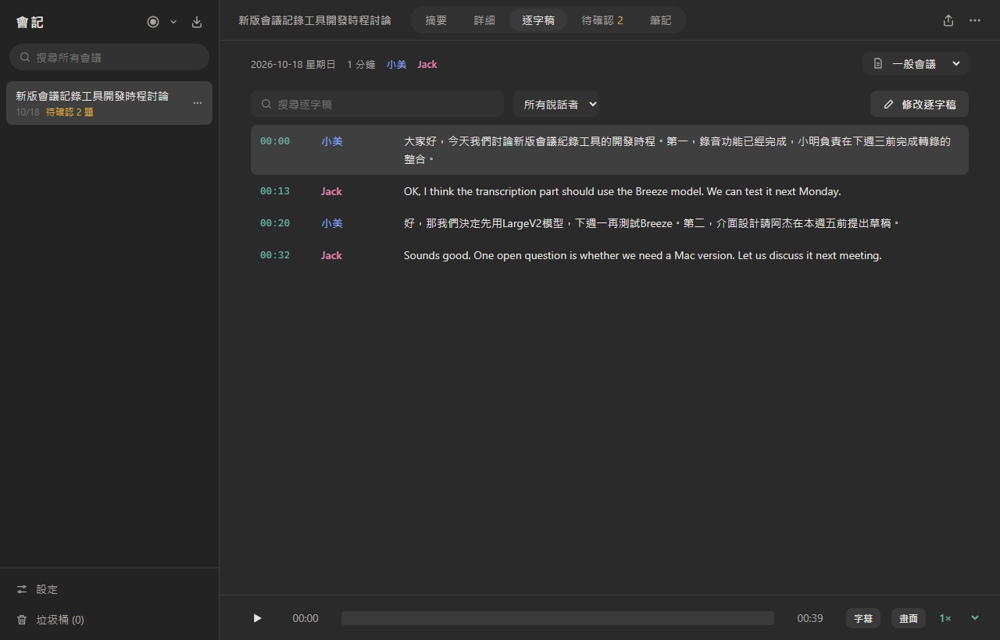
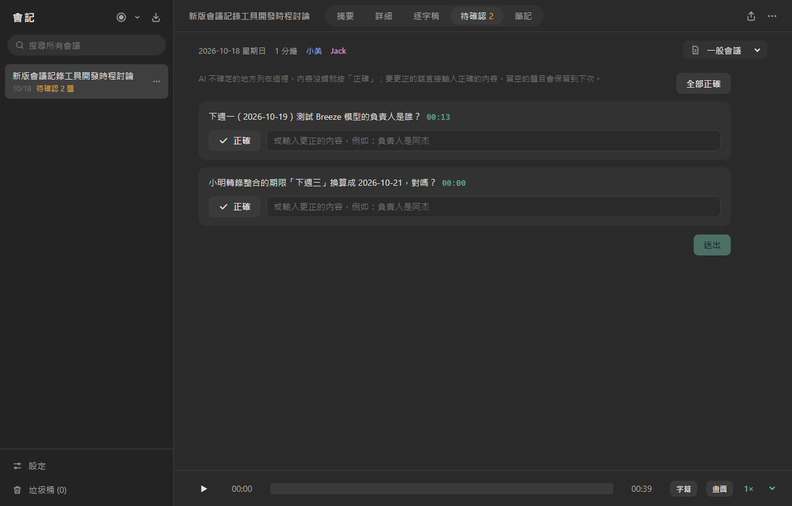
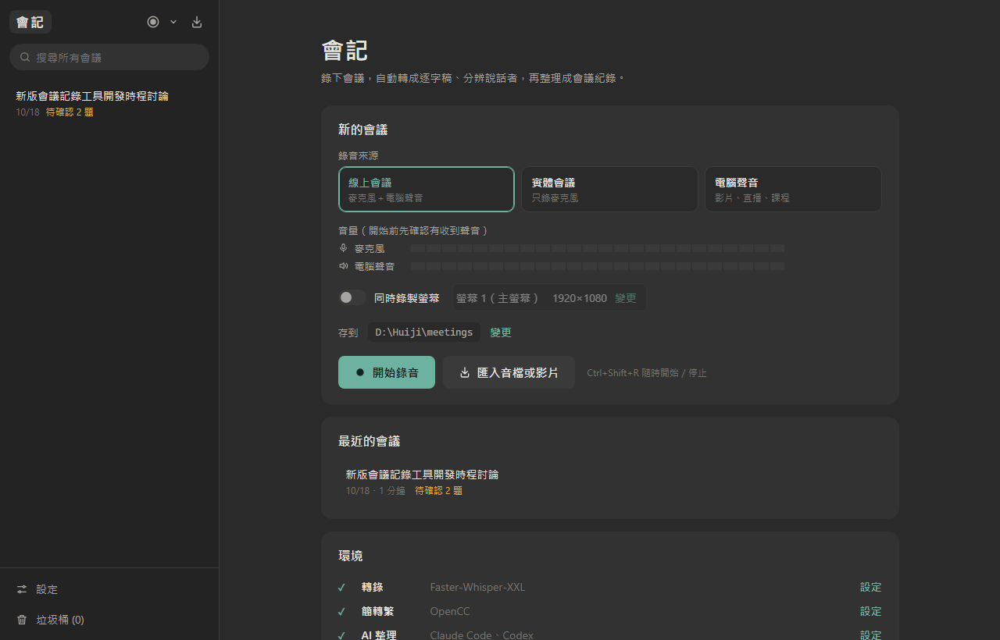
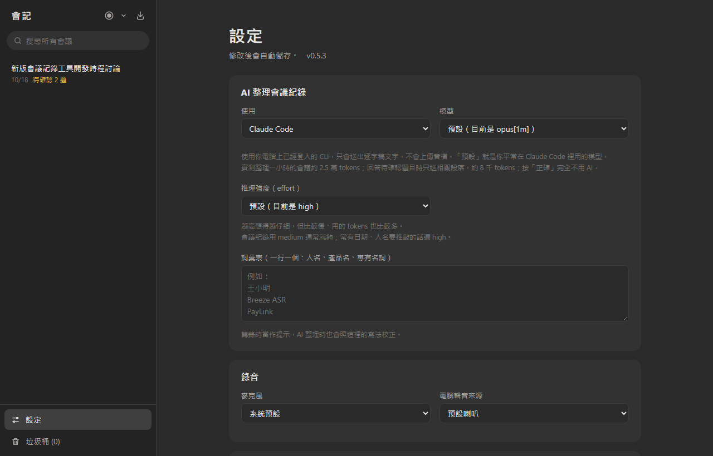
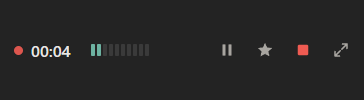

# 會記 Huiji

**Windows 上的 AI 會議紀錄工具。** 按一下開始錄音（也可以連螢幕一起錄），會議結束後自動轉成逐字稿、分辨說話者，再請 Claude 或 Codex 整理出摘要、決議和待辦事項。

錄音、轉錄、分辨說話者都在你的電腦上完成，只有逐字稿文字會送給 AI，音檔和影片不會離開你的電腦。

*A Windows meeting recorder: records mic + system audio (and optionally the screen), transcribes locally with Faster-Whisper, identifies speakers, and turns the transcript into structured meeting notes with Claude Code or Codex. UI in Traditional Chinese.*

[**下載最新版**](../../releases/latest)



## 為什麼做這個

原本開會的流程是：OBS 錄影 → 用 Whisper 轉逐字稿 → 把逐字稿貼給 AI 整理成紀錄。每一步都要手動，檔案也散在各處。

會記把這整串流程變成一個按鈕。介面與整理會議紀錄的方式參考自 macOS 的 [Shiyin 拾音](https://github.com/juinwei7/Shiyin)，這是 Windows 版的實作。

## 功能

**錄音與匯入**
- 三種錄音來源：線上會議（麥克風＋電腦聲音）、實體會議（只錄麥克風）、只錄電腦聲音
- 開始前首頁就有麥克風與電腦聲音的音量條，確認有收到聲音再錄
- 可以同時錄影，輸出畫面＋聲音的 `recording.mp4`（有 NVIDIA／Intel 顯示卡會用硬體編碼）
  - 像 OBS 一樣先看畫面再選：可以錄**整個螢幕**，或只錄**單一視窗**（被其他視窗蓋住也照錄，Chrome、Teams、Zoom 都錄得到）
- 錄音中可以暫停、標記重點（Ctrl+B），也可以邊錄邊記筆記，每換一行會自動加上錄音時間
- 錄音時可以縮成一個置頂的**小視窗**（計時、暫停、標記、停止），方便切回會議軟體
- 每場會議一個資料夾，名稱是「日期 時間 標題」（例如 `2026-10-20 10-03 週會`）；開始錄音前可以改存到其他資料夾
- 匯入以前的錄音或錄影（m4a、mp3、wav、mp4、mkv…），例如 OBS 錄的檔案；mkv、avi 等格式會自動轉成 mp4，播放時就看得到畫面（OBS 預設的 H.264 只換封裝、不重新壓縮，畫質不變）

**轉錄**
- 使用 [Faster-Whisper-XXL](https://github.com/Purfview/whisper-standalone-win)，逐段偵測語言，中英夾雜的會議不會漏掉英文句子
- 用 OpenCC 轉成台灣繁體用語，中文句子裡的半形標點會改成全形
- 用 pyannote 分辨說話者，點一下就能改名字
- 可以直接在逐字稿上改錯字、改某一句的說話者，改完可以用新的逐字稿重新整理會議紀錄
- 用「麥克風＋電腦聲音」錄的會議，會比對兩軌的音量，自動把你自己標成「我」
- 詞彙表：人名、產品名、專有名詞會當作轉錄提示，AI 整理時也會照這裡的寫法校正

**會議紀錄**
- 摘要、決議、待辦（負責人、期限）、未決問題、議題詳細
- 每一條都附時間點，點一下就跳到錄音的那一段
- 「下週三」這種說法會依會議日期換算成實際日期
- **待確認**：AI 不確定的人名、專有名詞、負責人、期限會列出來。內容沒錯就按「正確」（不會用到 AI）；要更正的直接輸入，AI 只會拿相關段落來修正紀錄
- 可以選 AI 模型（預設就是你在 Claude Code／Codex 裡用的模型），每次整理用了多少 tokens 會顯示在紀錄上方
- 範本：一般會議、一對一、訪談、課堂／演講、腦力激盪

**播放與閱讀**
- 有錄影的會議會多一個「影片」分頁：影片佔滿主畫面，右側欄可以切換逐字稿、摘要、詳細，逐字稿會跟著播放位置捲動；可以全螢幕（F），並用逐字稿當 **CC 字幕**（C 開關，大小可以在設定調整）
- 側欄、影片分頁的右側欄、錄音時的筆記欄都可以拖曳邊界調整大小；Ctrl＋加號／減號或 Ctrl＋滾輪可以放大整個介面
- 會議紀錄、逐字稿都可以用滑鼠反白複製

**匯出**
- 會議紀錄（Markdown，可以只要紀錄，也可以附上逐字稿）
- 字幕（SRT）：含說話者名稱的版本，以及給 YouTube 用的版本（一句一行、不含說話者，時間軸跟錄影一致）
- 影片（mp4）、音檔（m4a）

| 逐字稿 | 待確認 |
|---|---|
|  |  |

| 首頁 | 設定 |
|---|---|
|  |  |

錄音中的小視窗：



## 安裝

### 1. 安裝會記

到 [Releases](../../releases/latest) 下載 `Huiji-Setup-v<版本>.exe` 執行安裝。不需要系統管理員權限，也不需要安裝 Python。

安裝程式沒有數位簽章，Windows SmartScreen 可能會跳出「Windows 已保護您的電腦」，按「其他資訊 → 仍要執行」即可。

不想安裝的話，可以改下載 `Huiji-v<版本>-win64.zip`，解壓縮後直接執行 `Huiji\Huiji.exe`。

### 2. 準備轉錄工具

| 工具 | 用途 | 必要 |
|---|---|---|
| [Faster-Whisper-XXL](https://github.com/Purfview/whisper-standalone-win/releases) | 轉錄、分辨說話者 | 必要 |
| [OpenCC](https://github.com/BYVoid/OpenCC/releases) | 簡轉繁 | 選用（沒有的話逐字稿會是簡體） |
| [Claude Code](https://claude.com/claude-code) 或 [Codex CLI](https://github.com/openai/codex) | 整理會議紀錄 | 選用（沒有的話只產生逐字稿） |

- Faster-Whisper-XXL 下載後解壓縮到任意位置即可。有 NVIDIA 顯示卡會快很多，一小時的會議大約幾分鐘就轉完
- Claude Code 或 Codex 要先在終端機登入過一次，會記會直接使用你登入的帳號

### 3. 指定位置

打開會記，首頁的「環境」會顯示哪些工具已經找到。找不到的話，按旁邊的「設定」，填入 `faster-whisper-xxl.exe` 和 `opencc.exe` 的位置。

第一次轉錄時，Faster-Whisper-XXL 會下載語音模型和分辨說話者的模型，需要等比較久。

## 使用

1. 在首頁選錄音來源，看一下音量條有沒有動。要錄影的話打開「同時錄製螢幕」，按「變更」選要錄的螢幕或視窗
2. 按「開始錄音」。開會時可以按「小視窗」縮小，重要的地方按 Ctrl+B 標記，或在筆記欄記下重點
3. 按「停止並轉錄」，會記會依序合成影片、轉錄、分辨說話者、整理會議紀錄，這段時間可以去做別的事
4. 看「待確認」分頁，回答 AI 不確定的地方，按「依回答修正」；逐字稿有錯字可以在「逐字稿」分頁直接修改
5. 從右上角的匯出按鈕匯出需要的檔案；改名、重新整理、移到垃圾桶在旁邊的「⋯」，側欄每場會議右邊也有「⋯」

### 上傳到 YouTube 並加上字幕

錄完後從匯出按鈕選「影片」和「字幕：YouTube 用」。上傳影片後，到 YouTube Studio 的「字幕」上傳這個 SRT 檔即可。

### 快捷鍵

| 按鍵 | 功能 |
|---|---|
| Ctrl+Shift+R | 開始／停止錄音 |
| Ctrl+B | 錄音中標記重點 |
| 空白鍵 | 播放／暫停 |
| F | 影片全螢幕 |
| C | 開關字幕 |
| Ctrl＋加號／減號、Ctrl＋0 | 放大／縮小介面、還原 |

## 資料與隱私

- 錄音、錄影、轉錄、分辨說話者都在本機執行
- 只有逐字稿、你的筆記、詞彙表和會議日期會送給你選擇的 AI（Claude Code 或 Codex），音檔和影片不會上傳
- 會記本身不收集任何資料。唯一的連線是開啟時到 GitHub 檢查有沒有新版本，可以在設定裡關掉

| 內容 | 位置 |
|---|---|
| 會議 | `文件\Huiji\meetings\<日期 時間 標題>\`（可在設定中更改，錄音前也可以選別的資料夾） |
| 設定 | `%APPDATA%\Huiji\settings.json` |
| 錯誤紀錄 | `%APPDATA%\Huiji\huiji.log` |

每場會議的資料夾裡有：

| 檔案 | 內容 |
|---|---|
| `mic.wav`、`system.wav` | 分軌的原始錄音 |
| `audio.m4a` | 混音後的音檔 |
| `recording.mp4` | 螢幕錄影＋聲音（有錄螢幕時） |
| `transcript.json`、`transcript.srt` | 逐字稿 |
| `notes.json` | 會議紀錄 |

## 常見問題

**轉錄很慢？**
沒有 NVIDIA 顯示卡時，Faster-Whisper 只能用 CPU 跑，大模型會很慢。可以到設定把模型改成 `medium` 或 `small`。

**分辨說話者不準？**
如果知道與會人數，可以在設定裡填最少／最多人數。聲音很小或很少說話的人，有時會被併到別人身上。

**沒有自動把我標成「我」？**
這個功能是比對麥克風和電腦聲音兩軌。如果你用喇叭而不是耳機，麥克風會收到對方的聲音，兩軌差異不夠明顯，就不會自動標記。

**整理會議紀錄會用掉多少額度？**
實測一小時的會議（約 2.6 萬字逐字稿，Opus）整理一次約 2.5 萬 tokens；回答待確認的題目時只送相關段落，約 8 千 tokens；按「正確」完全不用 AI。想省一點可以在設定把模型改成 Sonnet。

**英文句子不見了？**
請確認設定裡的「逐段偵測語言」有打開。只指定中文時，Whisper 有時會略過英文句子。

## 開發

需要 Python 3.10 以上。

```bash
python -m venv .venv
.venv\Scripts\pip install -r requirements.txt
.venv\Scripts\python main.py                       # 開視窗
.venv\Scripts\python main.py --debug               # 開視窗＋開發者工具
.venv\Scripts\python main.py --dev                 # 不開視窗，用瀏覽器開 http://127.0.0.1:8765/?dev
.venv\Scripts\python -m unittest discover tests    # 測試
powershell -ExecutionPolicy Bypass -File build.ps1 # 打包成 dist\ 下的 zip 與安裝程式（安裝程式需要 Inno Setup 6）
```

也可以直接雙擊 `啟動會記.bat`，第一次執行會自動建立環境並安裝套件。

### 發布新版本

1. 改 `huiji/__init__.py` 的 `__version__`
2. commit 後打標籤並推送：`git tag v0.3.0 && git push origin main v0.3.0`
3. GitHub Actions 會自動打包，建立附上安裝程式與免安裝版的 Release（標籤要跟 `__version__` 一致，否則會失敗）

### 架構

```
main.py              進入點（pywebview 視窗）
huiji/
  recorder.py        WASAPI 錄音（麥克風＋loopback 分軌）
  screen.py          螢幕錄影（整個螢幕用 ffmpeg gdigrab）、來源預覽、合成 recording.mp4
  wincap.py          單一視窗錄影（PrintWindow，GPU 繪製的視窗也錄得到）
  transcribe.py      ffmpeg 混音 → Faster-Whisper-XXL → OpenCC
  selfvoice.py       比對麥克風／電腦聲音兩軌，找出哪個說話者是「我」
  notes.py           提示詞、範本、呼叫 claude / codex CLI、匯出 Markdown
  jobs.py            背景工作佇列（合成影片 → 轉錄 → 整理）
  store.py           會議資料夾的讀寫、搜尋、垃圾桶
  api.py             介面呼叫的 API
  server.py          本機 HTTP 伺服器（介面檔案＋音檔、影片串流）
  ui/                介面（HTML／CSS／JS）
installer/           Inno Setup 安裝程式腳本
```

## 致謝

- [Shiyin 拾音](https://github.com/juinwei7/Shiyin)：介面設計、會議紀錄的提示詞與範本（MIT License，見 [THIRD_PARTY_NOTICES.md](THIRD_PARTY_NOTICES.md)）
- [Faster-Whisper-XXL](https://github.com/Purfview/whisper-standalone-win)、[pyannote](https://github.com/pyannote/pyannote-audio)、[OpenCC](https://github.com/BYVoid/OpenCC)、[pywebview](https://github.com/r0x0r/pywebview)、[PyAudioWPatch](https://github.com/s0d3s/PyAudioWPatch)、[Inno Setup](https://jrsoftware.org/isinfo.php)

## 授權

[MIT License](LICENSE)。Faster-Whisper-XXL、OpenCC 等外部工具各自有自己的授權條款。
